<a href="https://sou-hardo.com"></a>


<a href="https://github.com/Sou-hardo?tab=repositories&sort=pushed"></a>

<a href="https://ledgercross.com"></a>

<a href="https://archelab.org"></a>

<a href="https://ledgercross.com"></a>
<a href="https://ledgercross.com"></a>
<a href="https://ledgercross.com"></a>
<a href="https://wifirank.site"></a>

<a href="https://sou-hardo.com/publications"></a>




<a href="https://sou-hardo.com"></a>
